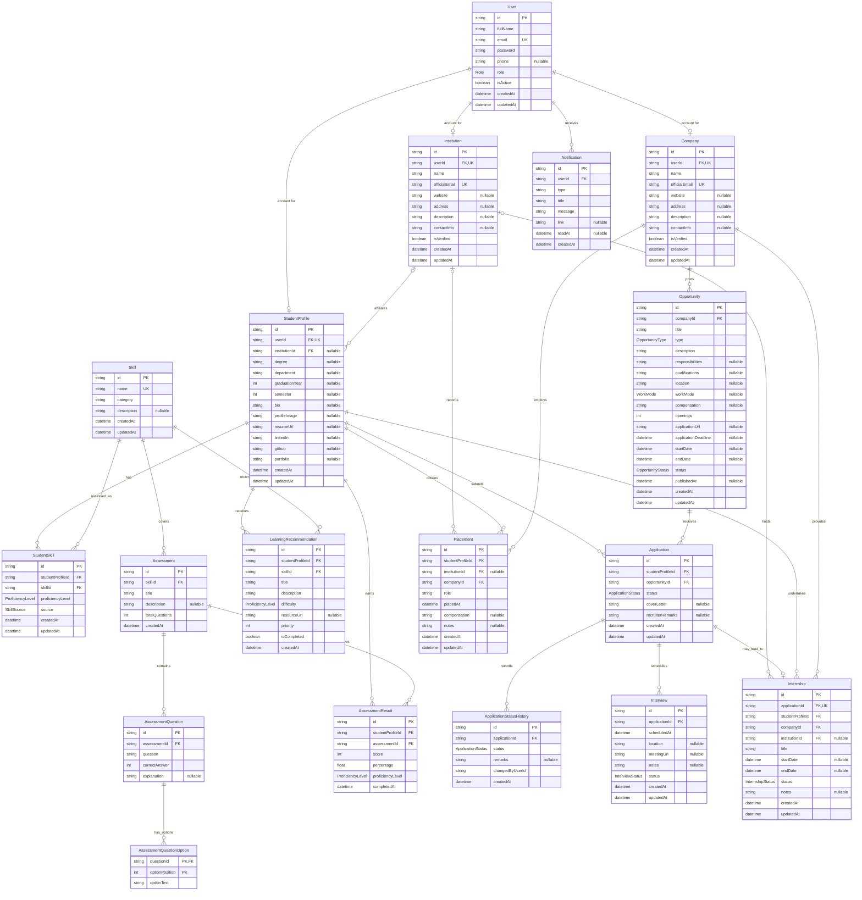

# AP CP2: ER Diagram — SkillBridge AI

The diagram below represents the proposed normalized design: the 17 original Prisma models plus `AssessmentQuestionOption`, which replaces the `options[]` field on `AssessmentQuestion`. `PK`, `FK`, and `UK` mark primary keys, foreign keys, and individually unique attributes. Composite unique constraints are `StudentSkill(studentProfileId, skillId)` and `Application(studentProfileId, opportunityId)`. The other unique constraints are `User.email`, `Institution.userId`, `Institution.officialEmail`, `StudentProfile.userId`, `Skill.name`, `Company.userId`, `Company.officialEmail`, and `Internship.applicationId`. Prisma relation-navigation fields are omitted. `changedByUserId` is intentionally not an FK. `correctAnswer` remains an integer; its indexing convention is unspecified.

